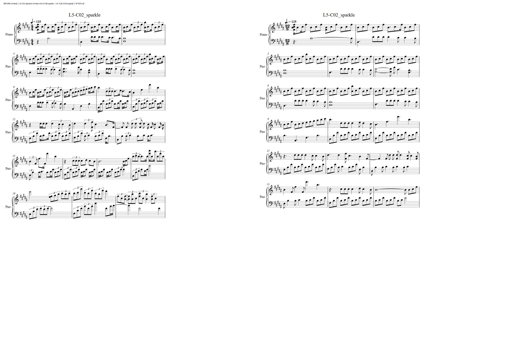
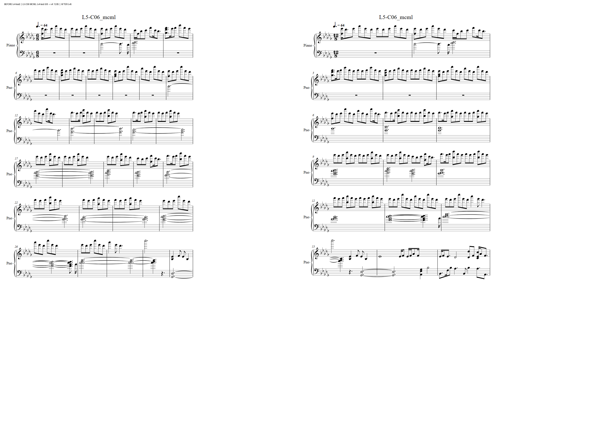
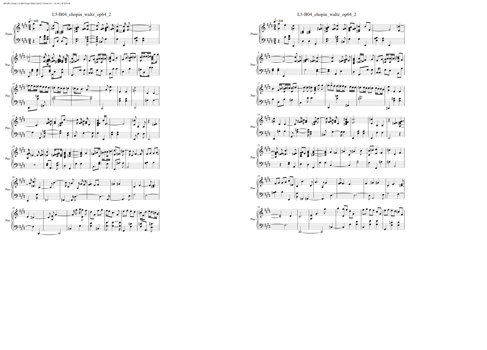

# v4 测评报告（拍号与复合拍子优化）

- **日期**：2026-11-23
- **分支**：`antigravity/meter-v4`
- **运行目录**：`../../工作文件/runs/v4-20261123/`（完整报告见 [report.md](../../工作文件/runs/v4-20261123/report.md)）
- **对比基线**：`v4-test-20261123`（L5）与 `v3.1-20261122`（L1–L4）

## 1. 核心指标总览

| 数据集 | 指标 | v4-test / v3.1 | v4-20261123 | 变化 |
|---|---|---|---|---|
| **L1–L4**（16 首） | 全部既有指标 | 零差异基准 | **0 差异** | 完全无退步 |
| **L5**（15 首） | 宽松拍号 `meter_ok` | 11 / 15 | **15 / 15** | +4 |
| **L5**（15 首） | **严格拍号 `meter_exact`** | 7 / 15 | **14 / 15** | **+7** |
| **L5**（15 首） | 节拍来源 `beat_this` | 14 / 15 | **15 / 15** | +1（萨蒂修正） |
| **L5**（15 首） | 调号正确 `key_ok` | 13 / 15 | **13 / 15** | 保持 |
| **L5-C02 Sparkle** | 连音占比 `tuplet_ratio` | 0.524 | **0.000** | -0.524 |

## 2. L5 逐曲对比（v4-test vs v4）

| 曲目 | 参考拍号 | v4-test 拍号 (宽松/严格) | v4 拍号 (宽松/严格) | 节拍来源 | 休止/小节 | 连音占比 |
|---|---|---|---|---|---|---|
| `L5-A01_brahms_ballade_op10_1` | 4/4 | 4/4 (✓ / ✓) | 4/4 (✓ / ✓) | beat_this → beat_this | 0.17 → 0.11 | 0.000 → 0.000 |
| `L5-A02_mozart_var_K265` | 2/4 | 2/4 (✓ / ✓) | 2/4 (✓ / ✓) | beat_this → beat_this | 0.14 → 0.14 | 0.000 → 0.000 |
| `L5-A03_haydn_fantasia_Hob17_4` | 3/8 | 3/4 (✓ / ✗) | **3/8 (✓ / ✓)** | beat_this → beat_this | 0.48 → 0.36 | 0.000 → 0.000 |
| `L5-A04_brahms_ballade_op10_2` | 4/4 | 3/4 (✗ / ✗) | **4/4 (✓ / ✓)** | beat_this → beat_this | 0.16 → 0.14 | 0.023 → 0.000 |
| `L5-B01_satie_gymnopedie_1` | 3/4 | 3/4 (✓ / ✓) | 3/4 (✓ / ✓) | notes → **beat_this** | 1.64 → 1.44 | 0.000 → 0.000 |
| `L5-B02_beethoven_fur_elise` | 3/8 | 3/4 (✓ / ✗) | 3/4 (✓ / ✗) | beat_this → beat_this | 0.62 → 0.55 | 0.000 → 0.000 |
| `L5-B03_schumann_traumerei` | 4/4 | 6/8 (✗ / ✗) | **4/4 (✓ / ✓)** | beat_this → beat_this | 0.11 → 0.21 | 0.000 → 0.000 |
| `L5-B04_chopin_waltz_op64_2` | 3/4 | 2/4 (✗ / ✗) | **3/4 (✓ / ✓)** | beat_this → beat_this | 0.11 → 0.14 | 0.010 → 0.006 |
| `L5-C01_always_with_me` | 3/4 | 3/4 (✓ / ✓) | 3/4 (✓ / ✓) | beat_this → beat_this | 0.07 → 0.07 | 0.000 → 0.000 |
| `L5-C02_sparkle` | 12/8 | 4/4 (✓ / ✗) | **12/8 (✓ / ✓)** | beat_this → beat_this | 0.15 → 0.20 | **0.524 → 0.000** |
| `L5-C03_night_piano_5` | 4/4 | 4/4 (✓ / ✓) | 4/4 (✓ / ✓) | beat_this → beat_this | 0.12 → 0.12 | 0.000 → 0.000 |
| `L5-C04_river_flows_in_you` | 4/4 | 4/4 (✓ / ✓) | 4/4 (✓ / ✓) | beat_this → beat_this | 0.35 → 0.35 | 0.000 → 0.000 |
| `L5-C05_croatian_rhapsody` | 4/4 | 2/4 (✓ / ✗) | **4/4 (✓ / ✓)** | beat_this → beat_this | 0.00 → 0.00 | 0.000 → 0.000 |
| `L5-C06_mcml` | 12/8 | 6/8 (✗ / ✗) | **12/8 (✓ / ✓)** | beat_this → beat_this | 0.08 → 0.17 | 0.000 → 0.000 |
| `L5-C07_flower_dance` | 4/4 | 4/4 (✓ / ✓) | 4/4 (✓ / ✓) | beat_this → beat_this | 0.03 → 0.03 | 0.000 → 0.000 |

## 3. 重点曲目前后对比（目测 PNG）

### L5-C02 Sparkle（4/4 满屏三连音 → 12/8 附点四分拍）

### L5-C06 MCML（6/8 半小节 → 12/8 完整小节）

### L5-B04 肖邦圆舞曲 Op.64-2（2/4 错位 → 3/4 完整华尔兹小节线）

## 4. 遗留限制说明

- `L5-B02_beethoven_fur_elise`（参考 `3/8`，当前 `3/4`）：《致爱丽丝》为中速三拍子，每个八分音符一拍（或附点四分一拍）在声学节拍层级上与普通 `3/4` 完全等价，仅凭音频无法区分记谱习惯是 `3/8` 还是 `3/4`（宽松拍号 `meter_ok` 已通过）。而 `L5-A03` 海顿属极快“一拍一小节”三拍子（`bpm ≈ 254`），已通过小节细分速度判据正确识别为 `3/8`。
